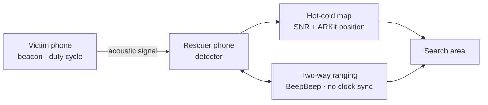

<div align="center">



<p>
  
  
  
  
</p>

<p><em>The name comes from the call rescuers shout over a collapsed building: "Can anyone hear me? Make a sound!"<br>
A phone under the rubble answers with a designed signal, and the rescuer's phone listens for it.</em></p>

</div>


## What it is

Ses Ver has two sides. The **victim side** turns a phone into an acoustic beacon that starts with one gesture and is built to last days on a single charge. The **rescuer side** listens for that beacon through noise and shows which way to dig.

Playing a loud sound from a phone is not new; whistle apps exist. The difference is doing four things together:

| | |
|---|---|
| **A data-carrying signal** | A designed beacon a rescuer's phone can detect much further away in noise, carrying how many people, whether anyone is injured and the time of the last touch. |
| **A critical alert chain** | A sequence of alerts that keeps the beacon going even after the app is closed. |
| **A 72-hour battery budget** | Duty-cycled playback planned to last three days and more. |
| **A rescuer tool** | Direction and area on the rescuer's phone, not just a sound to chase. |


## How the rescuer finds you

Multi-phone time-difference triangulation needs sub-millisecond clock sync and centimetre-level positions that a disaster zone cannot give, and sound travels through concrete faster than through air. So the MVP uses two methods that survive the field:




## Honest by design

This is a life-safety domain, so the project is strict about what it claims:

- **No "this saves lives" promise** in any store text until field data supports it.
- **A whistle is still recommended** on the preparation screen; the app is not a replacement.
- **Volume checks and a "last touch" field**, so an empty building's phone does not pull rescuers to the wrong place.
- **Field evidence first.** Speaker audibility through rubble and the 72-hour battery claim are measured on site before the interface grows.


## Türkçe özet

**Ses Ver**, enkaz altındaki bir telefonu günlerce dayanacak akustik bir işarete çeviren ve kurtarıcının telefonuyla bu işareti dinleyip yön gösteren bir uygulama. Kurban tarafı tek hareketle başlıyor; sinyal kaç kişi olduğunu, yaralı olup olmadığını ve son dokunuş zamanını taşıyor. Kurtarıcı tarafı sıcak-soğuk haritası ve saat eşitlemesi gerektirmeyen iki yönlü mesafe ölçümüyle arama alanını daraltıyor. iOS (Swift) ve Android (Kotlin) sürümleri var. Saha verisi gelmeden hiçbir "hayat kurtarır" iddiası yapılmıyor.


## Repository

```
App/SesVer/            iOS app: features, App Intents, localisation
Packages/Sources/      BeaconKit, DetectorKit, DeviceServices, DesignSystem, LocalizationKit
android/               Kotlin app with the same victim and rescuer flows
Spikes/                platform feasibility spikes (alarms, Siri offline, night watch power…)
research/              signal design and simulation
Tools/FieldRecorder/   field measurement tool
docs/                  ADRs, contracts, safety notes, field protocol
BLUEPRINT.md           the full plan (Turkish)
```

```sh
swift test --package-path Packages      # core signal and detector tests
cd android && ./gradlew test             # Android unit tests
```

<div align="center">
<br>
<a href="https://github.com/kutluhangil"></a>
<sub>Built for the minutes that matter · not a substitute for a whistle or for emergency services.</sub>
</div>
