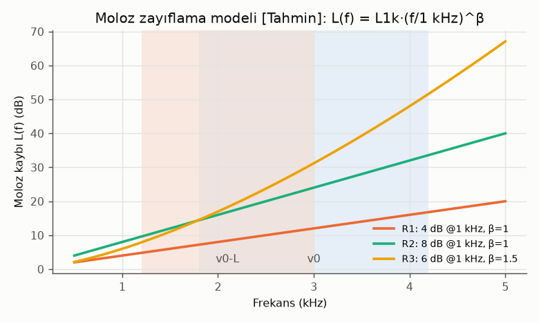
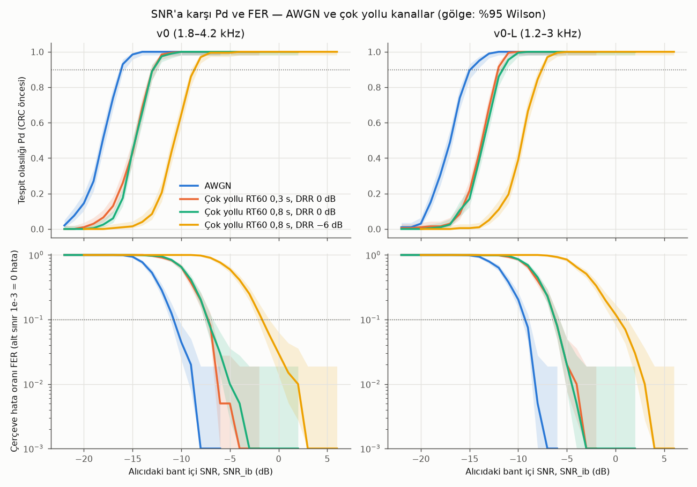
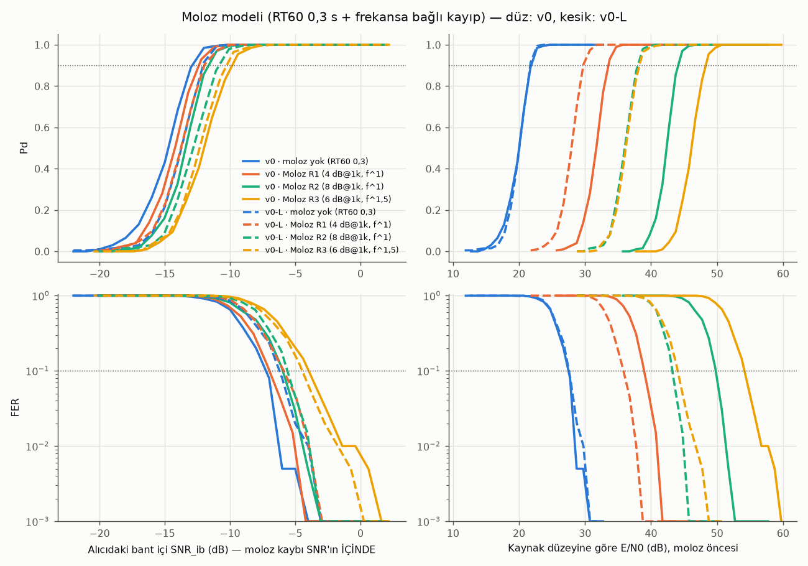
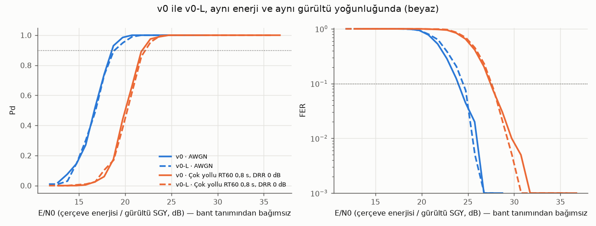
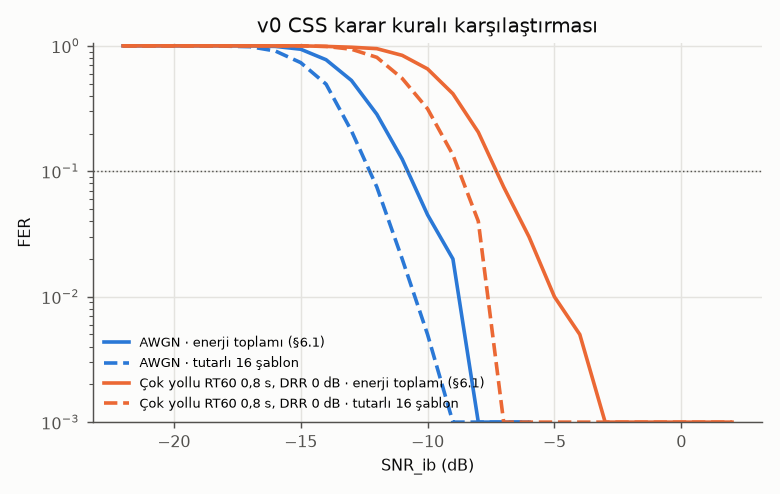
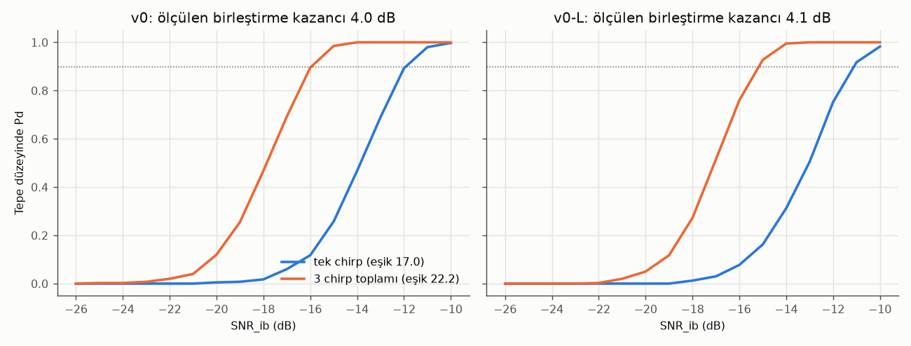

# F0-3 raporu: SignalSpec v0 simülasyonu (AWGN + çok yollu + moloz, iki bant varyantı)

> Sahip: `dsp-acoustics` · Tarih: 2026-10-20 · Sözleşme: `docs/contracts/signal-v0.md` (Taslak)
> Makine: Apple M6, 12 çekirdek, Python 3.15.0, numpy 2.5.4, scipy 1.18.1.
> Bütün rastgelelik sabit tohumlu. Her sayının yanında yeniden üretme komutu var. Komutlar depo kökünden çalışır.

## 0. Özet

| Soru | Sonuç |
|---|---|
| Eşlenik filtre işleme kazancı | Ölçülen **24,59 dB** (v0), teori 10·log10(B·Tp) = 24,59 dB. v0-L: 23,34 dB, teori aynı. |
| 3 giriş chirp'i birleştirme kazancı | Ölçülen **4,0 dB** (v0 ve v0-L). Tutarlı olmayan birleştirme teorisi 4,0–4,1 dB. Sözleşmedeki "+4,8 dB" yalnız tutarlı (coherent) üst sınırdır. |
| Pd = 0,9 için gereken SNR_ib (AWGN) | v0 **−16,2 dB**, v0-L **−14,9 dB** |
| FER = 0,1 için gereken SNR_ib (AWGN) | v0 **−10,7 dB**, v0-L **−9,2 dB** |
| Sınırlayan halka | Veri çözme. Tespit, çözmeden 5,5–7 dB önce gerçekleşiyor. "Duyuluyor ama okunamıyor" bölgesi geniş. |
| Aynı enerji ve aynı gürültü yoğunluğunda v0 ve v0-L (E/N0) | AWGN'de v0 0,3–0,5 dB önde. Çok yollu kanalda fark yok. |
| Moloz modeliyle, aynı hoparlör düzeyinde | v0-L FER = 0,1'e **3,2 / 6,5 / 10,1 dB** daha az kaynak enerjisiyle ulaşıyor (R1 / R2 / R3). Fark tamamen [Tahmin] moloz parametrelerinden geliyor. |
| Yanlış alarm, beyaz ve pembe gürültü | CRC öncesi 10–14 tespit/saat. CRC geçen sahte çerçeve 3 saatte 0 (%95 üst sınır 1,23/saat). |
| Yanlış alarm, sentetik şantiye gürültüsü | CRC öncesi **≈ 250 tespit/saat**. CRC geçen sahte çerçeve: v0 **1,33/saat** [0,36; 3,41], v0-L 0,67/saat [0,08; 2,41]. **BLUEPRINT §2.2 hedefi (≤ 1/saat) v0 için nokta kestiriminde aşılıyor.** |
| CPU (Python, tek çekirdek) | 1 sn ses başına **3,2–8,4 ms**, gerçek zaman faktörü **119–313×** |
| pytest | **30 geçti, 0 kaldı** |

## 1. Yapılanlar ve yeniden üretme

| Adım | Komut | Süre (duvar saati, bu Mac) |
|---|---|---|
| Testler | `research/.venv/bin/python -m pytest research/signal/tests -q` | 4 s |
| Test vektörleri | `research/.venv/bin/python research/signal/make_vectors.py` | 2 s |
| Eşik kalibrasyonu | `cd research/sim && ../.venv/bin/python calibrate_threshold.py` | 87 s |
| Pd / FER eğrileri | `cd research/sim && ../.venv/bin/python run_pd_fer.py` | 1 514 s |
| İşleme kazancı | `cd research/sim && ../.venv/bin/python run_gain.py` | 145 s |
| Yanlış alarm | `cd research/sim && ../.venv/bin/python run_false_alarm.py --hours 3` | 418 s |
| CPU | `cd research/sim && ../.venv/bin/python run_cpu.py` | ≈ 40 s |
| Grafik + özet | `cd research/sim && ../.venv/bin/python plot_report.py` | 5 s |
| Hepsi | `bash research/sim/run_all.sh` | ≈ 37 dk |

**Süre bütçesi aşıldı.** Hedef ~15 dk idi, toplam ≈ 37 dk sürdü. Ana neden Pd/FER koşusu (25 dk). 12 süreçli havuz bu makinede yalnız ≈ 4 kat hızlanıyor (bellek bant genişliği ve verimlilik çekirdekleri). Koşu sırasında sistemde başka yük de vardı (yük ortalaması 30–40). Daha hızlı yeniden üretim için `run_pd_fer.py --trials 100` kullanın: süre yarıya iner, güven aralıkları ≈ √2 kat genişler.

Ham sonuçlar `research/sim/results/` altında: `pdfer.json`, `gain.json`, `false_alarm.json`, `cpu.json`, `thresholds.json`. Özet tablolar `summary.json` içinde.

## 2. SNR tanımı

- **SNR_ib (birincil eksen)** = P_s,ib / P_n,ib.
  - P_s,ib: alıcıya ulaşan işaretin (kanal sonrası, gürültü öncesi) alıcı bandındaki enerjisi bölü **Ton = 992 ms (47 616 örnek)**.
  - P_n,ib: gürültünün aynı banttaki gücü.
  - Alıcı bandı v0 için **1,5–4,5 kHz** (W = 3 kHz). v0-L için **0,9–3,3 kHz** (W = 2,4 kHz). v0-L bandı aynı 300 Hz kenar payıyla seçildi, çünkü sözleşme v0-L için bant vermiyor.
  - Çok yollu kanalda **yankı enerjisi P_s'nin içindedir**. DRR = 0 dB demek, doğrudan yolun bu gücün yarısı (−3 dB) olması demektir.
- **SNR_wb** = SNR_ib + 10·log10(W / 24 kHz). Geniş bant (0–24 kHz) beyaz gürültü karşılığıdır: v0 −9,03 dB, v0-L −10,0 dB kayar.
- **E/N0** = SNR_ib + 10·log10(W · Ton). Çerçeve enerjisinin gürültü spektral yoğunluğuna oranıdır ve bant tanımından bağımsızdır. İki varyantın çerçeve enerjisi aynıdır (aynı A, aynı süreler). Bu yüzden v0 ile v0-L'yi adil karşılaştıran eksen budur.
- **Moloz kanalı:** Moloz kaybı SNR'ın **içinde**dir. Hoparlör düzeyi sabitken moloz, alıcıya ulaşan bant içi SNR'ı düşürür. Izgara kaynak SNR'ı (SNR_src, moloz öncesi) üzerinde kuruldu. Grafikler iki eksenle verildi:
  - alıcıdaki SNR_ib = SNR_src − L_ib
  - kaynak düzeyine göre E/N0
- Gürültü: beyaz Gauss (Pd/FER için).

## 3. Model

### 3.1 Alıcı (Python referansı, `research/signal/sesver_signal/receiver.py`)

Hat sırasıyla şöyle:

1. **Eşlenik filtre.** Çekirdek = bant geçiren FIR (511 tap, Kaiser β = 8) ⊛ analitik yükselen chirp. Korelasyon overlap-save FFT ile yapılır (N = 16 384).
2. **CFAR.** Ön ve arka pencere 2 048 örnek, koruma 64. Taban = max(küçük-olan, 0,25 × ortalama, ε).
3. **Üç tepe birleştirme.** Pn(U1) + maxpool±3(Pn)(U2) + maxpool±3(Pn)(U3) ≥ **η_c = 22,3**. Her tepe ≥ 2 olmalı. ±12 000 örnekte yerel maksimum aranır.
4. **Öz-girişim bastırma.** Bir çerçeve süresi içinde, kabul edilen adayın %10'undan zayıf aday reddedilir.
5. **İnce zamanlama.** Alçalan senk ile yapılır. Yükselen ve alçalan kestirimlerin ortalaması alınır. Fark 16 örnekten büyükse yalnız yükselen kestirim kullanılır.
6. **Sembol çözme.** Dechirp, ardından sıfır dolgulu FFT (v0: 3 200 nokta, v0-L: 3 840 nokta). Böylece s·B/M tam sayı bine düşer. Karar: |Z(sB/M)|² + |Z(sB/M − B)|² (sözleşme §6.1). Ardından Gray, CRC.

η_c, beyaz gürültüde CRC öncesi ≈ 10 tespit/saat verecek şekilde kalibre edildi: 2 saat/durum, tohum 31001, `thresholds.json`. Kalibre eşikler:

| Durum | η_c |
|---|---|
| v0, 3 tepe | 22,25 |
| v0-L, 3 tepe | 22,3 |
| v0, tek tepe | 17,0 |
| v0-L, tek tepe | 16,6 |

### 3.2 Kanallar

| Kod | Tanım |
|---|---|
| `awgn` | Yalnız beyaz gürültü |
| `mp03` | Stokastik RIR: h[0] = 1 (doğrudan yol), 1 ms'den başlayan üstel sönümlü Gauss kuyruk. RT60 = 0,3 s, DRR = 0 dB. |
| `mp08` | Aynı RIR, RT60 = 0,8 s, DRR = 0 dB |
| `mp08h` | Aynı RIR, RT60 = 0,8 s, DRR = −6 dB (sert durum: doğrudan yol zayıf) |
| `rub1–3` | `mp03` + frekansa bağlı moloz kaybı L(f) = L1k · (f / 1 kHz)^β dB (sıfır fazlı süzgeç) |

Her denemede yeni RIR ve yeni yük çekilir.

**Moloz parametreleri [Tahmin]:**

| Set | L1k | β | Bant içi kayıp L_ib (v0 / v0-L) |
|---|---|---|---|
| R1 | 4 dB | 1,0 | 11,2 / 7,9 dB |
| R2 | 8 dB | 1,0 | 21,0 / 15,1 dB |
| R3 | 6 dB | 1,5 | 23,4 / 14,7 dB |

Seçim gerekçesi:

- Gözenekli ve taneli ortamlarda yutum frekansla artar. Viskoz sınır tabakası rejiminde ≈ f^0,5, saçılma veya düşük frekans rejiminde f^2'ye kadar çıkar. Bu yüzden β = 1 merkez, β = 1,5 sert eğim seçildi.
- Mutlak düzeyler, bant içi kaybı ≈ 10–25 dB aralığına yayacak şekilde seçildi. Bu, "insan kulağının sınırında" bir derinliği temsil etmesi amaçlanan bir varsayımdır.
- **Bu değerler hiçbir ölçüme dayanmıyor.** F0-4 saha verisiyle değiştirilmeli. Grafik: `figs/rubble_model.png`.

Mutlak kayıp yalnız kaynak eksenini kaydırır. Alıcıdaki SNR eksenindeki fark, yalnız spektral eğimin (etkin bant daralması) etkisidir.



### 3.3 Deneme düzeni (`run_pd_fer.py`)

- Her deneme şöyle kurulur: 0,30–0,40 s gürültü, çerçeve (+ RIR kuyruğu), 0,5 s gürültü, ardından akış sıfırlarla boşaltılır.
- Nokta başına **200 deneme**, 1 dB adım, tohum 41002.
- Her denemenin gerçekleşmesi (yük, ofset, RIR, birim gürültü) bütün SNR noktalarında ölçeklenerek kullanılır (ortak rastgele sayılar).
- **Tespit (Pd):** başlangıcı gerçeğin ±100 örneğinde olan herhangi bir aday (CRC öncesi).
- **FER** = 1 − P(CRC geçen ve W'si doğru olay). Kaçırılan tespitler FER'in içindedir.
- **Güven aralığı:** %95 Wilson. Gereken SNR için aralık, Wilson alt ve üst eğrilerinin 0,9 / 0,1 düzeyini kestiği noktalardır.

## 4. Sonuçlar: Pd ve FER

Komut: `cd research/sim && ../.venv/bin/python run_pd_fer.py && ../.venv/bin/python plot_report.py`. Sayılar `results/summary.json` dosyasındadır.



### 4.1 Gereken SNR (alıcıda), 200 deneme/nokta, köşeli parantez %95 aralığı

| Varyant | Kanal | Pd=0,9 SNR_ib | SNR_wb | E/N0 | FER=0,1 SNR_ib | SNR_wb | E/N0 |
|---|---|---|---|---|---|---|---|
| v0 | AWGN | −16,2 [−16,4; −15,8] | −25,2 | 18,6 | −10,7 [−11,1; −10,2] | −19,7 | 24,1 |
| v0 | RT60 0,3, DRR 0 | −12,9 [−13,2; −12,5] | −21,9 | 21,8 | −7,2 [−7,5; −6,7] | −16,2 | 27,6 |
| v0 | RT60 0,8, DRR 0 | −12,9 [−13,1; −12,4] | −21,9 | 21,9 | −7,2 [−7,5; −6,6] | −16,2 | 27,5 |
| v0 | RT60 0,8, DRR −6 | −8,6 [−9,0; −8,3] | −17,7 | 26,1 | −1,6 [−2,1; −1,0] | −10,7 | 33,1 |
| v0-L | AWGN | −14,9 [−15,2; −14,2] | −24,9 | 18,9 | −9,2 [−9,5; −8,8] | −19,2 | 24,6 |
| v0-L | RT60 0,3, DRR 0 | −12,1 [−12,2; −11,7] | −22,1 | 21,7 | −6,1 [−6,4; −5,7] | −16,1 | 27,6 |
| v0-L | RT60 0,8, DRR 0 | −11,6 [−12,0; −11,2] | −21,6 | 22,2 | −6,1 [−6,4; −5,7] | −16,1 | 27,6 |
| v0-L | RT60 0,8, DRR −6 | −7,6 [−7,9; −7,2] | −17,6 | 26,2 | +0,4 [−0,3; +1,3] | −9,6 | 34,2 |

### 4.2 Moloz kanalları (RT60 0,3 s + moloz)

| Varyant | Moloz | L_ib (dB) | Pd=0,9 SNR_ib (alıcı) | FER=0,1 SNR_ib (alıcı) | Pd=0,9 E/N0 (kaynak) | FER=0,1 E/N0 (kaynak) |
|---|---|---|---|---|---|---|
| v0 | yok (`mp03`) | 0 | −12,9 | −7,2 | 21,8 | 27,6 |
| v0 | R1 | 11,2 | −12,4 [−12,6; −12,0] | −6,9 [−7,3; −6,4] | 33,6 | 39,1 |
| v0 | R2 | 21,0 | −11,6 [−12,0; −11,3] | −5,9 [−6,2; −5,4] | 44,1 | 49,9 |
| v0 | R3 | 23,4 | −9,8 [−10,2; −9,5] | −3,9 [−4,4; −3,3] | 48,3 | 54,3 |
| v0-L | yok (`mp03`) | 0 | −12,1 | −6,1 | 21,7 | 27,6 |
| v0-L | R1 | 7,9 | −12,0 [−12,2; −11,4] | −5,9 [−6,2; −5,2] | 29,7 | 35,9 |
| v0-L | R2 | 15,1 | −10,8 [−11,1; −10,5] | −5,4 [−5,7; −5,1] | 38,0 | 43,4 |
| v0-L | R3 | 14,7 | −10,3 [−10,6; −9,9] | −4,4 [−4,8; −3,8] | 38,3 | 44,1 |





### 4.3 Yorum

1. **Veri çözme sınırlayıcı.** AWGN'de tespit için −16,2 dB yetiyor, ama FER = 0,1 için −10,7 dB gerekiyor (v0). Arada 5,5 dB fark var. Çok yollu kanalda fark 5,7 dB, sert kanalda 7 dB. Bu, BLUEPRINT §3.3'teki "insanın duyamayacağı gürültü altında yakalar" iddiasının **tespit** için geçerli olduğunu gösteriyor. **Veri okuma** (kaç kişi, son dokunuş) için geçerli değil.
2. **Yankıda belirleyici olan RT60 değil, DRR.** RT60 0,3 s ile 0,8 s (ikisi de DRR 0 dB) neredeyse aynı sonucu verdi. DRR 0'dan −6 dB'e inince FER eşiği ≈ 5,5 dB (v0) ve 6,5 dB (v0-L) kötüleşti. SNR tanımı yankı enerjisini içerdiği için, doğrudan yola göre bu kaybın bir kısmı (≈ 1,8 dB) tanımdan gelir. Kalanı semboller arası girişimdir: 4 ms gecikmeli bir yol, dechirp sonrası tam bir kaydırma adımına (150 Hz) düşer.
3. **v0 ile v0-L, aynı enerjide (E/N0).** AWGN'de v0, Pd'de 0,3 dB, FER'de 0,5 dB daha iyi (B·Tp daha büyük). Çok yollu kanalda fark ölçüm belirsizliği içinde. Moloz varken v0-L, kaynak düzeyine göre R1/R2/R3'te 3,2 / 6,5 / 10,1 dB daha iyi. Bu üstünlük **tamamen [Tahmin] moloz modelinden** geliyor ve şunları hesaba katmıyor:
   - hoparlörün 1,2 kHz'teki daha düşük verimi
   - pembe ve şantiye gürültüsünün düşük frekansta daha güçlü olması
   - insan kulağının 1,2 kHz'te 3 kHz'e göre daha az duyarlı olması

   Bant seçimi F0-4 verisi olmadan yapılmamalı.
4. **Yanlış kabul (CRC geçen yanlış W).** Bütün eğrilerde 17 394 "tespit edildi ama doğru çözülmedi" olayına karşı **40 yanlış kabul** oldu (≈ 1/435). CRC-8'in rastgele hata için beklenen geçirme oranı 1/256'dır. Eşik çevresinde arayüze yanlış alan değerleri ulaşabilir (yanlış id, yanlış kişi sayısı).
5. **Zamanlama.** Yüksek SNR'da başlangıç hatası RMS 0,3–1,4 örnek (`timing_rms_samples`).

### 4.4 CSS karar kuralı (ek deney)

Sözleşme §6.1'deki enerji toplamı (iki bin) ile 16 tam sembol şablonuyla tutarlı korelasyon karşılaştırıldı. Tutarlı korelasyon, sarma öncesi ve sonrası parçaları faz uyumlu toplar.

| Kanal | FER=0,1, enerji | FER=0,1, tutarlı | Kazanç |
|---|---|---|---|
| v0 AWGN | −10,7 dB | −12,2 [−12,5; −11,7] dB | **1,5 dB** |
| v0 RT60 0,8 | −7,2 dB | −8,6 [−9,0; −8,2] dB | **1,4 dB** |



Hesap maliyeti: sembol başına 16 × 3 072 karmaşık çarpma-toplama. Gerçek zaman için önemsiz. Bu karar kuralı sözleşmeyi bozmaz (§6.1 bilgi niteliğinde).

## 5. İşleme kazancı: ölçülen ve teorik

Komut: `cd research/sim && ../.venv/bin/python run_gain.py`. Sonuçlar `results/gain.json`.

**Eşlenik filtre kazancı** = SNR_out / SNR_in,B.

- SNR_in,B: chirp'in 120 ms üzerinden ortalama gücü, B bandındaki gürültüye bölünür.
- SNR_out: alıcının gerçek çekirdeğiyle (FIR dahil) |y_tepe|² / E|y_gürültü|².
- Zarf (karmaşık) dedektörü faz bilmediği için E/(2σ²) verir. Bu tanımla teori B·Tp'dir.

| Varyant | Ölçülen | Teori 10·log10(B·Tp) | Alıcı bandına göre (W·Tp) |
|---|---|---|---|
| v0 | 24,59 dB | 24,59 dB (288) | 25,56 dB |
| v0-L | 23,34 dB | 23,34 dB (216) | 24,59 dB |

Pencere rampası işaret enerjisini 0,23 dB azaltır. Ortalama güç gerçek enerjiden hesaplandığı için bu kayıp kazanca yansımaz. Gürültü varyansı Monte Carlo ile doğrulandı (3 000 örnek: oran 1,03 / 0,98).

**Üç chirp birleştirme**, tepe düzeyinde ölçüldü:

- Gerçek tepe konumunda tek chirp Pn ≥ η₁ ile 3 tepe toplamı C ≥ η₃ karşılaştırıldı.
- İki eşik de beyaz gürültüde aynı ön tespit oranına (10/saat) kalibre edildi.
- 400 deneme/nokta, tohum 51003.

| Varyant | Pd=0,9 tek chirp | Pd=0,9 üç chirp | Ölçülen kazanç | Teori (tutarlı olmayan, aynı eşikler) | Teori (aynı hücre Pfa) | Tutarlı üst sınır |
|---|---|---|---|---|---|---|
| v0 | −11,9 dB | −15,9 dB | **4,0 dB** | 4,1 dB | 4,0 dB | 4,77 dB |
| v0-L | −11,1 dB | −15,2 dB | **4,1 dB** | 4,0 dB | 4,0 dB | 4,77 dB |

Uygulama kaybı da ölçüldü. Kayıp kaynakları CFAR kestirim gürültüsü ve maxpool'dur. Teorik gereksinim −15,7 dB (v0), ölçülen −15,9 dB. Fark ±0,3 dB içinde, ölçüm belirsizliği düzeyinde. v0-L'de teori −14,7, ölçülen −15,2.

Teori ile Monte Carlo bu tanımlarda uyuşuyor. BLUEPRINT'teki "~24,6 dB + ~4,8 dB" ifadesinin ilk kısmı doğrulandı. İkinci kısım **tutarlı olmayan birleştirmede ≈ 4,0 dB**'dir.



## 6. Yanlış alarm (yalnız gürültü)

Komut: `cd research/sim && ../.venv/bin/python run_false_alarm.py --hours 3`.

- Durum başına 3 saat ses: 30 dakikalık 6 bağımsız akış, blok 4 800 örnek.
- Tohum 61004, kalibrasyondan farklı.
- Güven aralığı: %95 Poisson (Garwood).
- Şantiye gürültüsü **tamamen sentetik** [Tahmin]. Bileşenler `research/sim/noise_models.py` içinde: pembe taban, 18–30 Hz kırıcı darbeleri, çekiç rezonansları, motor harmonikleri, 2,5–4,5 kHz taşlama tonu, geri vites uyarısı, yelp siren, 0,8–5 kHz rastgele gıcırtı taramaları.

| Gürültü | Varyant | CRC öncesi tespit/saat | CRC geçen sahte çerçeve | /saat [%95] | Beklenen (ön/256) |
|---|---|---|---|---|---|
| Beyaz | v0 | 12,3 [8,7; 17,0] | 0 | 0 [0; 1,23] | 0,05 |
| Beyaz | v0-L | 10,3 [7,0; 14,7] | 0 | 0 [0; 1,23] | 0,04 |
| Pembe | v0 | 14,0 [10,1; 18,9] | 0 | 0 [0; 1,23] | 0,05 |
| Pembe | v0-L | 10,3 [7,0; 14,7] | 0 | 0 [0; 1,23] | 0,04 |
| Şantiye (sentetik) | v0 | **252** [234; 271] | 4 (2 `beacon`, 2 `response`) | **1,33 [0,36; 3,41]** | 0,98 |
| Şantiye (sentetik) | v0-L | **254** [237; 273] | 2 (`beacon`) | 0,67 [0,08; 2,41] | 0,99 |

**Sonuç:**

- Beyaz ve pembe gürültüde eşik hedefe uyuyor.
- Sentetik şantiye gürültüsünde CRC öncesi tespit 20 kat artıyor. Sahte çerçeve oranı, CRC-8'in 1/256 geçirme oranıyla tutarlı olarak ≈ 1/saat düzeyinde. Bu, **BLUEPRINT §2.2 hedefinin (≤ 1/saat) sınırında veya üstünde**.
- Hangi şantiye bileşeninin adayları ürettiği ayrıştırılmadı (ölçülmedi). En yüksek aday metriği v0'da C = 3 119 oldu. Bu, bazı girişimlerin chirp'e çok benzediğini gösteriyor.
- Yalnız CRC-8 ile ≤ 1/saat hedefi güvenceye alınamaz. Ek doğrulama gerekli (bkz. §8).

## 7. CPU

Komut: `cd research/sim && ../.venv/bin/python run_cpu.py`.

- Ölçüm: `time.process_time`, tek süreç, tek iş parçacığı, 120 sn ses, 3 tekrarın en iyisi.
- Senaryolar: yalnız gürültü ve her 10 sn'de bir çerçeve (SNR_ib = −10 dB).

| Varyant | Senaryo | Blok | ms / 1 sn ses | Gerçek zaman faktörü |
|---|---|---|---|---|
| v0 | yalnız gürültü | 1 024 | 8,4 | 119× |
| v0 | yalnız gürültü | 4 800 | 3,2 | 313× |
| v0 | 10 sn'de bir çerçeve | 1 024 | 3,5 | 288× |
| v0 | 10 sn'de bir çerçeve | 4 800 | 4,9 | 203× |
| v0-L | yalnız gürültü | 1 024 | 3,6 | 276× |
| v0-L | yalnız gürültü | 4 800 | 3,6 | 278× |
| v0-L | 10 sn'de bir çerçeve | 1 024 | 5,6 | 179× |
| v0-L | 10 sn'de bir çerçeve | 4 800 | 5,3 | 189× |

Dağılım gürültülü. Ölçüm sırasında sistemde başka yük vardı. Senaryo ile blok boyu arasında tutarlı bir sıralama yok. Güvenilir aralık: **3–9 ms/sn, RTF > 100×**.

Bu sayılar Python/numpy içindir. Swift + vDSP sayısı bu rapordan çıkarılamaz (ölçülmedi). Baskın maliyet 16 384 noktalı FFT çiftidir (≈ 4,6 blok/sn).

Akış alıcısının ham giriş tamponu en çok **115 873 örnektir** (≈ 2,4 sn, `max_history_samples()`). Karar gecikmesi ≈ çerçeve süresi + 0,25 sn.

## 8. Sözleşme bulguları (architect için, sözleşme DEĞİŞTİRİLMEDİ)

1. **§5, 60 sn penceresinde görev döngüsü ≤ %12 (ZORUNLU) en kötü durumda aşılıyor.**
   - Bütün aralıklar alt sınırda (8,5 sn) olursa herhangi bir 60 sn penceredeki görev döngüsü **%12,41** olur.
   - Ölçüm: `sesver_signal.timing.max_window_duty`. Test: `test_worst_case_60s_window_duty_reported`.
   - Olasılık pratikte çok küçük: 200 adet 6 saatlik rastgele çizelgede 0 aşım.
   - Kural yine de kesin dille yazılmış. Öneri: verici, aralığı çekerken son 60 sn'lik açık süreyi kontrol edip kırpsın. Ya da sapma alt sınırı ≥ 0,86 olsun (bütün aralıklar 8,6 sn iken en kötü pencere %11,57, ölçüldü).
2. **§6.1 bant geçireni yalnız v0 için tanımlı.** v0-L alıcı bandı yok. Bu çalışmada 0,9–3,3 kHz kullanıldı.
3. **§6.1 "+4,8 dB" ifadesi** tutarlı birleştirme üst sınırıdır. Önerilen tutarlı olmayan birleştirme için ölçülen ve teorik değer ≈ **4,0 dB**. Metin "≈ +4 dB" olarak düzeltilmeli.
4. **§6.1 CSS karar kuralı** (iki binin enerji toplamı), 16 şablonla tutarlı korelasyona göre **1,4–1,5 dB** kayıp veriyor. Bilgi bölümünde tutarlı yöntem önerilebilir.
5. **§4.2 CRC.** HD = 4 iddiası kaba kuvvetle doğrulandı [Kesin]. Ağırlığı ≤ 3 olan her 24 bitlik hata yakalanıyor ve ağırlık 4 kod sözcüğü var. Ama CRC-8 rastgele hatalı çözümlerin ≈ 1/256'sını geçiriyor:
   - Pd/FER koşularında 40 yanlış kabul / 17 394 çözülemeyen tespit.
   - Sentetik şantiye gürültüsünde 0,7–1,3 sahte çerçeve/saat.

   Öneri: alıcı tarafında doğrulama kuralı (ör. aynı `id`'nin, §5 aralığıyla uyumlu ikinci bir çerçevede görülmeden "işaret" olarak gösterilmemesi). Ya da v1'de daha uzun CRC. Bu, BLUEPRINT §2.2 yanlış alarm hedefi için gerekli görünüyor.
6. **§3.3 sarma koşulu.** `t < tw` ile `n < 3072 − 192·s` her s için aynıdır (tw tam sayı örneğe düşer). Swift'te kayan nokta karşılaştırması yerine tam sayı indeks kullanılması sözleşmeye not edilebilir.
7. **§3.4 çıkış rampası.** "Aynanın simetriği" `w[N−1−i] = w[i]` olarak uygulandı. Böylece son örnek 0 olur. Metinde formül olarak yazılması belirsizliği kaldırır.
8. **SNR tanımı sözleşmede yok.** F0-4 ile karşılaştırma için §2'deki tanım (bant içi, Ton üzerinden) sözleşmeye veya ADR-0002'ye eklenebilir.
9. Doğrulanan sayılar: çerçeve 59 136 örnek, Ton 47 616, ±100 ppm ≤ 5,9 örnek, 8 işarette id çakışması %0,68, nominal görev döngüsü %9,92, sapma ile en kötü %11,67 (çerçeve başına).

## 9. Sınırlar (modellenmeyenler)

- **Gerçek moloz yok.**
  - Moloz, tek bir frekansa bağlı kayıp eğrisi + oda benzeri stokastik RIR ile temsil edildi. Parametreler [Tahmin].
  - Gerçekte şunlar modellenmedi: katı içinden yayılım (beton ~3 000–4 000 m/s), boşluk rezonansları, kipsel yapı, doğrudan yolun tamamen yokluğu ve frekansa bağlı RT60.
  - DRR'nin sonuca etkisi büyük (§4.3). Değeri sahada ölçülmeli.
- **Donanım yok.** Şunlar modellenmedi: hoparlör frekans yanıtı (1,2 kHz'te verim düşüşü v0-L aleyhine), hoparlör bozulması ve kırpma, telefon kılıfı, cebin veya kumaşın süzmesi, mikrofon yanıtı, iOS ses işleme (AGC, gürültü bastırma, `measurement` modu), 48 kHz dışı örnekleme.
- **Gürültü.** Pd/FER yalnız beyaz Gauss gürültüyle çalışıldı. Şantiye gürültüsü sentetiktir ve gerçek kayıt yerine geçmez. Pembe veya şantiye gürültüsü altında Pd/FER ölçülmedi.
- **Hareket yok.** Doppler, kurtarıcının yürürken telefonu gezdirmesi ve kurtarıcı tarafında zamanla değişen kanal modellenmedi. Yalnız sabit ±100 ppm saat farkı test edildi (birim test, Monte Carlo değil).
- **Çakışan işaretler.** Yalnız çakışmayan iki işaret test edildi. Çakışma olasılığı ve çakışmada kayıp ölçülmedi.
- **İnsan algısı yok.** "İnsan menzilinin 2 katı" karşılaştırması bu simülasyonda yapılmadı (F0-4).
- **CPU.** Python ölçümü yük altındaki bir makinede yapıldı. Swift/vDSP ve iPhone ölçülmedi.
- **Monte Carlo süresi.** Bütçe aşıldı (§1). Nokta başına 200 deneme gereken SNR'ı ≈ ±0,3–0,5 dB belirsizlikle veriyor. Daha ince karşılaştırmalar (ör. çok yollu kanalda v0 ile v0-L) bu belirsizliğin içinde kalıyor.

## 10. Kulak güvenliği

Bu çalışma hiçbir parametre değişikliği önermiyor. Genlik (−1 dBFS), görev döngüsü (%9,9 nominal) ve süreler sözleşmedeki gibi kullanıldı. Önerilen alıcı tarafı değişiklikler (tutarlı CSS kararı, doğrulama kuralı) vericiyi etkilemez. §8/1'deki öneri görev döngüsünü yalnız düşürür. F0-6 ritim örneklerinde (`research/signal/rhythms/`) alternatif ritim C, v0 ile aynı açık süreye (992 ms) sahiptir.

## 11. Ek: pytest çıktısı

```
$ research/.venv/bin/python -m pytest research/signal/tests -q
..............................                                           [100%]
30 passed in 3.97s
```
