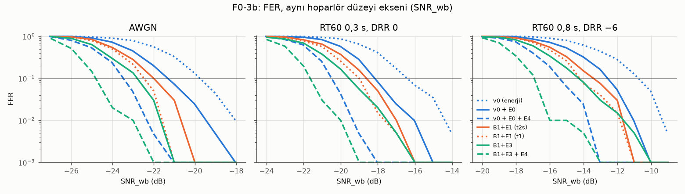
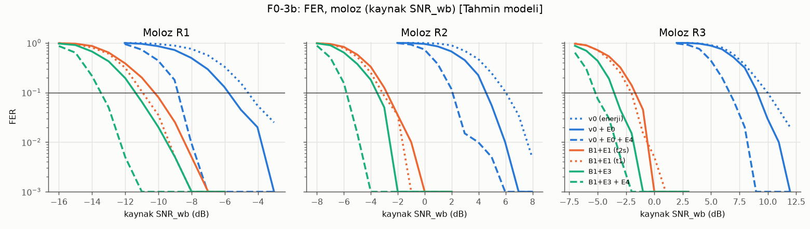

# F0-3b raporu: SignalSpec v1 adayları (ADR-0004)

> Sahip: `dsp-acoustics` · Tarih: 2026-10-20 · Bağımlılık: F0-3 · ADR: `docs/adr/0004-signal-v1-candidates.md` (Taslak)
> Makine: F0-3 ile aynı (Apple M6, 12 çekirdek, Python 3.15.0, numpy 2.5.4, scipy 1.18.1). Bütün rastgelelik sabit tohumlu.
> Komutlar depo kökünden çalışır. v0 kodu ve v0 test vektörleri **değiştirilmedi**.

## 0. Özet

- **E0 (tutarlı CSS kararı) ve E4 (iki çerçeveyi metrik düzeyinde birleştirme) v0'da format değiştirmeden 3,7 dB kazandırıyor (AWGN).** FER 0,1 için gereken SNR_wb −19,6 dB'den −23,3 dB'e iniyor. E0'ın payı 1,6 dB, E4'ün payı 2,1 dB. E4'ün 1,0 dB'i yalnızca ikinci çerçeveyi beklemekten geliyor.
- **E1 yalnız `t_max = 1` ile kullanılabilir.** RS(10,6) iki hatayı düzeltecek şekilde çalıştırılırsa (`t = 2`) rastgele bir adayın %15,7'sini kabul ediyor. Sentetik şantiye gürültüsünde bu **38,5 sahte çerçeve/saat** demek. `t = 1` ile oran 0,33/sa, CRC-8'in 1,0/sa'inden düşük.
- **Ölçülen en iyi v1 adayı: B1 + E1 (`t = 1`) + P1, alıcıda E0 + E4.** Aynı hoparlör düzeyinde v0 + E0 + E4'e göre kazanç: AWGN'de 1,1 dB, sert yankıda (DRR −6) 1,0 dB. [Tahmin] moloz modeli R2'de kazanç 7,2 dB, ama bu tamamen moloz varsayımına dayanıyor.
- **ADR-0004'teki iki görev döngüsü telafisi tek başına yetmiyor.**
  - E1'in `Ton` değeri 1,12 sn. En kötü 60 sn penceresinde görev döngüsü %13,07.
  - 100 ms chirp ile %12,13, nominal 11 sn ile yine %13,07 çıkıyor. İkisi de %12'yi aşıyor.
  - Yetenler: E1 için nominal aralık ≥ 11,6 sn, ya da `Ton` ≤ 1,028 sn.
- **V-a tek başına yetmiyor.** v0 alıcısı yüksek SNR'da v1 çerçevelerini tespit ediyor ve **çerçevelerin %0,2–1,0'ında CRC'yi geçen sahte çözüm** üretiyor. Ters yönde, `t = 2` kullanan bir v1 alıcısı v0 çerçevesi adaylarının %15'ini kabul ediyor.
- pytest: **42 geçti** (önceki 30 + 12 yeni).

## 1. Adaylar ve kurulum

| Kod | Dalga biçimi | Yük / koruma | `Ton` |
|---|---|---|---|
| v0 | B0 (1,8–4,2 kHz), 8 × 64 ms | v0 düzeni + CRC-8 | 0,992 sn |
| v0-L | B1 (1,2–3,0 kHz), 8 × 64 ms | v0 düzeni + CRC-8 (yalnız bant etkisini ayırmak için) | 0,992 sn |
| v1-E1 | B1, 10 × 64 ms | P1 (24 bit) + RS(10,6) GF(16), CRC yok | 1,120 sn |
| v1-E1s | v1-E1, giriş ve senk chirp'leri 100 ms | aynı | 1,040 sn |
| v1-E3 | B1, 8 × 96 ms | P1 + CRC-8 | 1,248 sn |
| v1-E1E3 | B1, 10 × 96 ms | P1 + RS(10,6) | 1,440 sn |

**Alıcı kararları (aynı tespit üzerinde):**

| Kod | Karar |
|---|---|
| `en` | v0 enerji kararı (sözleşme §6.1) |
| E0 (`coh`) | 16 şablonla tutarlı korelasyon |
| `rs_t0/t1/t2` | E0 sonrası RS çözme, en çok 0/1/2 sembol düzeltme |
| `rs_t2s` | `t = 2`, ama her düzeltilen sembolün yeni değeri o sembolün metrik sıralamasında 2. aday olmalı (yumuşak doğrulama) |
| `+sel` | 1. veya 2. çerçeve tek başına doğru (birleştirme yok, yalnız bekleme) |
| `+E4` | 1. veya 2. çerçeve doğru, ya da iki çerçevenin E0 metrikleri toplanıp çözülünce doğru |

**Kod:**

| Dosya | İçerik |
|---|---|
| `research/signal/sesver_signal/rs16.py` | GF(16) (x⁴+x+1), sistematik RS(10,6), d_min = 5. Çözme, kalan tablosuyla yapılır: ağırlığı ≤ 2 olan 10 275 hata deseni. Swift'e bit düzeyinde taşınabilir. |
| `research/signal/sesver_signal/v1.py` | P1 paketleme, v1 çerçeveleri ve `V1Receiver`. `V1Receiver` v0 tespit hattını aynen kullanır, çözmede yumuşak metrik döndürür. `decode_metrics` karar verir. |
| `research/signal/tests/test_v1.py` | Testler: RS gidiş-dönüş; 2 hata düzeltme; `t = 1` ile 3 hatanın tamamının tespiti; `t = 2` ile 3 hatanın orijinale dönmemesi ve çoğunun tespiti (< %50 yanlış düzeltme); kabul oranı formülü; P1; 4 v1 dalga biçiminin temiz çözümü; `V1Receiver` enerji kararının v0 alıcısıyla aynı kaydırmaları vermesi. |

**SNR ve kanal tanımları F0-3 §2–3 ile aynı:**

- SNR_ib, alıcı bandında `Ton` üzerinden hesaplanır.
- Kanallar: AWGN, RT60 0,3 s/DRR 0 dB (`mp03`), RT60 0,8 s/DRR −6 dB (`mp08h`) ve moloz R1–R3 (`mp03` + [Tahmin] eğim). `mp08` atlandı, çünkü F0-3'te `mp03` ile aynı çıktı.
- Eşikler F0-3'ten: η_c 22,25 (B0) ve 22,3 (B1). B1 giriş bölümü v0-L ile aynı olduğu için yeniden kalibre edilmedi.
- v1-E1s'te chirp kısa ama B aynı. CFAR ile normalize edilmiş C metriğinin gürültü dağılımı chirp süresinden bağımsız olduğu için aynı η_c kullanıldı [Muhtemel; kalibre edilmedi].

**Karşılaştırma ekseni:**

- Adaylar arasında karşılaştırma **SNR_wb** = SNR_ib + 10·log10(W / 24 kHz) üzerinden yapıldı.
- Hoparlör genliği aynı olduğu için işaret gücü de aynıdır. Aynı beyaz gürültü yoğunluğunda bu eksen, bant farkını (W) ve `Ton` farkını kendiliğinden hesaba katar.
- Moloz satırlarında **kaynak SNR_wb** (moloz öncesi) kullanıldı.
- SNR_ib ve E/N0 değerleri `research/sim/results/f03b_summary.json` içinde.

**Deneme düzeni:**

- 200 deneme/nokta, 1 dB adım. Izgara, F0-3 eşiklerinin −2…+2 dB çevresi.
- Tohum 41102. Ortak rastgele sayılar kullanıldı.
- %95 Wilson aralığı, F0-3 §3.3'teki gibi.
- F0-3'ten farklar:
  - Akış sonunda `flush` yok. Gerçek çerçevenin tespiti ve çözümü flush'sız tamamlanıyor. Bu yüzden Pd/FER etkilenmez, yalnız kuyruktaki sahte adaylar sayılmaz.
  - E4 için her denemede aynı kanal gerçekleşmesine ikinci bağımsız gürültü eklendi.
- Tutarlılık kontrolü: v0 `en` AWGN FER 0,1 bu koşuda −10,6 dB, F0-3'te −10,7 dB. v0-L `en` bu koşuda −9,4, F0-3'te −9,2. Pd: −15,9'a karşı −16,2. Fark aralıkların içinde.

## 2. Karar tablosu

- Değerler dB SNR_wb. Köşeli parantez %95 aralığı.
- Moloz R2 sütunları kaynak düzeyidir ve [Tahmin] modele dayanır.
- E4 satırlarında Pd tek çerçeve Pd'sidir. E4 yalnız çözmeyi etkiler.
- Yanlış kabul: 18 saat sentetik şantiye gürültüsü, %95 Poisson.
- CPU: Python, tek çekirdek, 10 sn'de bir çerçeve, blok 1 024 ve 4 800. Değer aralığı iki blok boyunu kapsar.

| Aday | FER 0,1 AWGN | FER 0,1 RT60 0,8/DRR −6 | FER 0,1 moloz R2 (kaynak) | Pd 0,9 AWGN | Pd 0,9 R2 (kaynak) | Yanlış kabul/sa, kuralsız | Yanlış kabul/sa, iki çerçeve kuralı | Ton (s) | En kötü 60 sn (I = 10 sn, 0,86) | CPU ms/sn |
|---|---|---|---|---|---|---|---|---|---|---|
| v0 (B0, enerji kararı, CRC-8) — referans | −19,6 [−20,0; −19,2] | −10,6 [−11,1; −10,1] | +6,0 [+5,7; +6,6] | −24,9 [−25,2; −24,3] | +0,4 [+0,1; +0,8] | 0,89 [0,51; 1,44] (n=16) | 0 gözlendi (%95 üst 0,20) | 0,992 | 11,57 % | 3,7–4,1 |
| v0 + E0 | −21,2 [−21,5; −20,7] | −12,4 [−12,8; −12,0] | +4,7 [+4,5; +4,9] | −24,9 [−25,2; −24,3] | +0,4 [+0,1; +0,8] | 1,11 [0,68; 1,72] (n=20) | 0 gözlendi (%95 üst 0,20) | 0,992 | 11,57 % | 3,5–3,8 |
| v0 + E0 + E4 | −23,3 [−23,5; −23,0] | −15,3 [−15,6; −14,8] | +2,1 [+1,9; +2,5] | −24,9 [−25,2; −24,3] | +0,4 [+0,1; +0,8] | 1,28 [0,81; 1,92] (n=23) | 0 gözlendi (%95 üst 0,20) | 0,992 | 11,57 % | 3,7–4,4 |
| B1 + E0 (yalnız bant, v0-L) | −21,2 [−21,5; −20,8] | — | — | −25,0 [−25,2; −24,5] | — | ölçülmedi | ölçülmedi | 0,992 | 11,57 % | ölçülmedi |
| B1 + E1 RS t=1 + P1 | −22,3 [−22,5; −22,1] | −14,1 [−14,3; −13,5] | −3,1 [−3,3; −2,4] | −25,0 [−25,2; −24,6] | −5,8 [−6,1; −5,5] | 0,33 [0,12; 0,73] (n=6) | 0 gözlendi (%95 üst 0,20) | 1,120 | 13,07 % (aşar) | 3,5–3,8 |
| B1 + E1 RS t=1 + P1 + E4 | −24,4 [−24,5; −24,2] | −16,3 [−16,6; −15,9] | −5,1 [−5,2; −5,0] | −25,0 [−25,2; −24,6] | −5,8 [−6,1; −5,5] | 0,61 [0,31; 1,09] (n=11) | 0 gözlendi (%95 üst 0,20) | 1,120 | 13,07 % (aşar) | 3,5–3,8 |
| B1 + E1 RS t=2 + P1 | −23,3 [−23,6; −23,1] | −15,1 [−15,4; −14,5] | −4,1 [−4,3; −3,7] | −25,0 [−25,2; −24,6] | −5,8 [−6,1; −5,5] | 38,50 [35,69; 41,48] (n=693) | 0 gözlendi (%95 üst 0,20) | 1,120 | 13,07 % (aşar) | 3,5–3,8 |
| B1 + E1 RS t=2 yumuşak doğrulamalı (t2s) | −22,0 [−22,2; −21,4] | −13,3 [−13,9; −12,6] | −2,7 [−3,0; −2,2] | −25,0 [−25,2; −24,6] | −5,8 [−6,1; −5,5] | 0,22 [0,06; 0,57] (n=4) | 0 gözlendi (%95 üst 0,20) | 1,120 | 13,07 % (aşar) | 3,5–3,8 |
| B1 + E1 (chirp 100 ms) RS t=1 | −22,3 [−22,6; −22,0] | — | — | −24,2 [−24,5; −23,7] | — | ölçülmedi | ölçülmedi | 1,040 | 12,13 % (aşar) | ölçülmedi |
| B1 + E3 + P1 (CRC-8) | −22,7 [−23,0; −22,3] | −14,2 [−14,6; −13,6] | −3,4 [−3,7; −3,1] | −24,9 [−25,1; −24,4] | −6,1 [−6,3; −5,6] | 1,00 [0,59; 1,58] (n=18) | 0 gözlendi (%95 üst 0,20) | 1,248 | 14,56 % (aşar) | 4,1–4,5 |
| B1 + E3 + P1 + E4 | −24,6 [−25,0; −24,3] | −16,8 [−17,1; −16,5] | −5,6 [−5,9; −5,4] | −24,9 [−25,1; −24,4] | −6,1 [−6,3; −5,6] | 1,06 [0,64; 1,65] (n=19) | 0 gözlendi (%95 üst 0,20) | 1,248 | 14,56 % (aşar) | 4,1–4,5 |
| B1 + E1 + E3 RS t=1 | −24,2 [−24,4; −24,0] | — | — | −25,2 [−25,4; −24,9] | — | 0,78 [0,43; 1,30] (n=14) | 0 gözlendi (%95 üst 0,20) | 1,440 | 16,80 % (aşar) | ölçülmedi |

**Diğer kanallar** (FER 0,1, SNR_wb):

| Aday | `mp03` | R1 (kaynak) | R3 (kaynak) |
|---|---|---|---|
| v0 `en` | −16,3 | −4,5 | +10,0 |
| v0 + E0 | −18,1 | −5,7 | +9,2 |
| v0 + E0 + E4 | −20,3 | −8,5 | +6,7 |
| v0-L + E0 | −17,6 | — | — |
| B1 + E1 t=1 | −19,0 | −11,0 | −2,1 |
| B1 + E1 t=1 + E4 | −21,2 | −12,8 | −4,6 |
| B1 + E3 | −19,4 | −11,3 | −3,4 |
| B1 + E3 + E4 | −21,4 | −13,3 | −5,1 |
| B1 + E1s t=1 | −19,0 | — | — |

Bu sayılar `f03b_summary.json` içindeki SNR_ib değerine `wb_offset_db` (moloz satırlarında ayrıca `rubble_loss_ib_db`) eklenerek elde edilir.





### 2.1 Yorum

1. **E0.**
   - Ölçülen kazanç: 1,6 dB (AWGN), 1,8 dB (`mp03`, `mp08h`), 1,3 dB (R2). F0-3'teki 1,4–1,5 dB ile uyumlu.
   - Yanlış kabul 0,89'dan 1,11/sa'e çıktı. Aralıklar örtüşüyor, fark anlamlı değil.
   - CPU farkı ölçüm gürültüsünün içinde.
2. **E4.**
   - E0 üzerine 2,1 dB (AWGN), 2,2 dB (`mp03`), 2,9 dB (`mp08h`), 2,6 dB (R2).
   - Bunun 1,0–1,4 dB'i birleştirme gerektirmez: ikinci çerçeveyi beklemek yeter (`+sel`).
   - Bedeli bir aralık (≈ 10 sn) gecikme.
   - Gürültüde aday eşleştirme pencereyle yapılır (Δt ∈ [8,6; 11,5] sn). Bu, sahte kabulü 18 saatte 899 ek CRC denemesi karşılığında 3 çerçeve artırdı (1,11 → 1,28/sa). Beklenen ≈ çift sayısı / 256.
   - Simülasyon iki çerçevede **aynı kanalı** varsaydı (kurtarıcı ve işaret sabit). Hareket varsa kazanç düşer (ölçülmedi).
3. **B1 bandı tek başına (v0-L + E0).**
   - AWGN'de v0 + E0 ile aynı (−21,2 / −21,2). `mp03`'te 0,5 dB geride.
   - Bandın kazancı yalnız moloz modelinden geliyor (F0-3 §4.3 ile aynı sonuç). Hoparlörün 1,2 kHz'teki verimi ölçülmeden bu kazanç kesin değil.
4. **E1 (RS).**
   - `t` seçimi belirleyici.
     - `t = 2` FER'de en iyi: v0-L + E0'a göre AWGN'de 2,1 dB. Ama rastgele adayların %15,7'sini kabul ediyor (teori 10 276/65 536). Ölçülen değerler:
       - Şantiye: 693 sahte / 18 sa = 38,5/sa
       - Pd/FER koşularında tespit edilip doğru çözülmeyen denemelerin %9–19'u yanlış alanla kabul edildi (AWGN: 50 / 367)
     - `t = 1`: v0-L + E0'a göre 1,1 dB. Kabul oranı 1/434 (ölçülen 0,33/sa). `t = 1` iken ≤ 3 hata her zaman tespit edilir (test).
     - `t2s`: `t = 1`'den 0,3 dB kötü, sahte kabulde benzer (0,22/sa). Ek karmaşıklığa değmiyor.
     - `t = 0`: yalnız tespit. 18 saatte 0 sahte kabul. FER'de v0-L + CRC'den daha iyi değil (−10,7 dB SNR_ib).
   - Sonuç: E1, "`t_max = 1`" normatif yazılırsa güvenli.
5. **E3 (96 ms sembol).**
   - FER'de E1 t=1'den 0,4 dB iyi (aralıklar örtüşüyor). v0-L + E0'a göre 1,5 dB. Bu, beklenen +1,8 dB sembol enerjisinin büyük kısmı.
   - Sahte kabul CRC-8 düzeyinde kalıyor (1,0/sa).
   - `Ton` 1,248 sn, nominal 10 sn'de bile ortalama görev döngüsü %12,5. Bütçe için nominal ≥ 13,8 sn gerekiyor.
6. **E1 + E3.**
   - AWGN'de en iyi tek çerçeve FER (−24,2).
   - `Ton` 1,44 sn olduğu için nominal ≥ 17 sn gerekiyor. Pratik değil.
7. **100 ms chirp (E1s).**
   - Pd'de 0,8 dB kayıp (AWGN −25,0 → −24,2). Teori: 10·log10(120/100) = 0,79 dB.
   - FER değişmedi.
8. **Tespit ile çözme arası fark kapanıyor.**
   - v0 `en`: FER 0,1 ile Pd 0,9 arasında 5,3 dB vardı.
   - B1 + E1 t=1 + E4: aynı fark 0,6 dB'e iniyor.
   - Bu noktada sınırlayan halka yeniden tespit oluyor.

## 3. Yanlış kabul (sentetik şantiye gürültüsü, 18 sa/geçiş)

Komut: `research/.venv/bin/python research/sim/run_f03b_false_alarm.py --hours 18` (164 s). Çıktı: `results/f03b_false_alarm.json`.

- Gürültü üreticisi ve tohum F0-3 ile aynı. İlk 3 saat F0-3'teki gürültünün aynısı.
- İki tespit geçişi yapıldı: B0 ve B1. B1 adayları v1-E1, v1-E3 ve v1-E1E3 düzenleriyle ayrı ayrı çözüldü.
- CRC öncesi aday: B0 245/sa, B1 255/sa. F0-3'te 252 ve 254 idi.

| Düzen / karar | Kuralsız /sa | +E4 /sa (E4 çift sayısı) | İki çerçeve kuralıyla | Aynı id tekrarı |
|---|---|---|---|---|
| v0 `en` | 0,89 [0,51; 1,44] | 1,00 (893) | 0 (≤ 0,20) | 0 |
| v0 E0 | 1,11 [0,68; 1,72] | 1,28 (899) | 0 (≤ 0,20) | 0 |
| v1-E1 t=0 | 0 [0; 0,20] | 0 | 0 | 0 |
| v1-E1 t=1 | 0,33 [0,12; 0,73] | 0,61 (932) | 0 (≤ 0,20) | 0 |
| v1-E1 t=2 | **38,5** [35,7; 41,5] | 43,7 (664) | 0 (≤ 0,20) | 84 |
| v1-E1 t2s | 0,22 [0,06; 0,57] | 0,44 (934) | 0 (≤ 0,20) | 0 |
| v1-E3 | 1,00 [0,59; 1,58] | 1,06 (933) | 0 (≤ 0,20) | 0 |
| v1-E1E3 t=1 | 0,78 [0,43; 1,30] | 0,83 (929) | 0 (≤ 0,20) | 0 |

**İki çerçeve kuralı** (signal-v0 §6): aynı id, Δt ∈ [8,6; 207] sn, `people` ve `injured` aynı, `lifeAge` geri gitmiyor.

- Bütün adaylarda 18 saatte 0 doğrulanmış sahte işaret çıktı (%95 üst sınır 0,20/sa).
- Analitik kestirim [Tahmin, rastgele id varsayımı]: λ² · Δ · P(eşleşme).
  - CRC'li adaylarda λ ≈ 1/sa için ≈ 1·10⁻⁶/sa.
  - E1 t=2'de λ = 38,5/sa için ≈ 7·10⁻⁴/sa.
- Kural, rastgele sahte çerçevelere karşı yeterli. Belirlenimci sahte çerçevelere (§4) karşı tam değil.

## 4. Sürüm ayrımı: v0 alıcısı ve v1 çerçeveleri (V-a)

Komut: `research/.venv/bin/python research/sim/run_f03b_crossver.py --frames 1000` (156 s, Pd/FER koşusuyla eş zamanlı). Çıktı: `results/f03b_crossver.json`.

- Her durumda 1 000 rastgele yüklü çerçeve, beyaz gürültüyle.
- SNR_ib, vericinin kendi bandında.
- Alıcı: değiştirilmemiş v0 `StreamingReceiver`.

| v1 çerçevesi | SNR_ib | v0 CRC öncesi aday | CRC geçen sahte (enerji / E0) | Çerçeve başına [%95] |
|---|---|---|---|---|
| v1-E1 | +20 dB | 1 364 | 2 / 9 | %0,2 [0,02; 0,7] / %0,9 [0,4; 1,7] |
| v1-E1 | 0 dB | 1 215 | 6 / 4 | %0,6 / %0,4 |
| v1-E1 | −10 dB | 15 | 0 / 0 | ≤ %0,37 |
| v1-E3 | +20 / 0 dB | 936 / 1 277 | 5 / 6 · 4 / 6 | %0,4–0,6 |
| v1-E1E3 | +20 / 0 dB | 899 / 1 345 | 5 / 10 · 5 / 4 | %0,4–1,0 |
| v1-E1s | +20 / 0 dB | 347 / 532 | 0 / 1 · 4 / 2 | %0–0,4 |

**Bulgular:**

- B1 giriş chirp'i v0 eşlenik filtresine 1,8–3,0 kHz örtüşmesi üzerinden bağlanıyor. Yüksek SNR'da çerçeve başına > 1 aday üretiyor.
- −10 dB'de tespit neredeyse yok. Sorun, yakındaki (yüksek SNR) v1 işaretleriyle sınırlı.
- **V-a tek başına yetmiyor.** v0 alıcısı yakındaki bir v1 işaretinden saatte ≈ 360 çerçeve duyar. Bu, saatte ≈ 0,7–3,6 CRC'li sahte çerçeve demek.

**Belirlenimcilik testi.** Komut: `run_f03b_crossver.py --repeat` (92 s). Çıktı: `results/f03b_crossver_repeat.json`.

- Yöntem: sahte çözüm üreten yük, yeni gürültüyle 5 kez daha gönderildi. Aynı id'nin tekrar çıkıp çıkmadığına bakıldı.
- v1-E1: 1 500 çerçevede 6 sahte çıktı. Tekrar gönderimde 30 denemenin 1'inde aynı id geri geldi.
- v1-E3: 1 500 çerçevede 5 sahte çıktı. Tekrar gönderimde 25 denemenin 1'inde aynı id geri geldi.
- Sonuç: sahte çözüm çoğunlukla gürültüye bağlı. Ama yaklaşık %4 olasılıkla aynı id tekrar ediyor. Bu oran rastgele id beklentisinden (1/4 094) çok yüksek. Bu yüzden iki çerçeve kuralı bu durumda zayıflar.

**Ters yön** (B1 alıcısı + v0 çerçeveleri, +20 / 0 dB):

| Karar | v0 aday sayısının kabul edilen kısmı |
|---|---|
| RS t=2 | 199/1 317 · 147/1 028 (**≈ %14–15**) |
| RS t=1 | 3/1 317 · 4/1 028 (≈ %0,2–0,4) |
| E3 CRC-8 | 7/1 317 · 5/1 028 (≈ %0,5) |

Geçiş döneminde (v0 ve v1 telefonları birlikte) `t = 2` alıcısı kullanılamaz.

## 5. Görev döngüsü ve telafiler

Komutlar:

- `research/.venv/bin/python research/sim/run_f03b_cpu_duty.py` (39 s): `timing.max_window_duty`, bütün aralıklar 0,86·I iken.
- `research/.venv/bin/python research/sim/f03b_defer_rate.py` (≈ 3 s): 10⁶ çerçevelik rastgele çizelge.

| Aday | `Ton` | Nominal I | Nominal görev döngüsü | En kötü 60 sn | ≤ %12 için en küçük I (alt sınır 0,86) | ≤ %12 için alt sınır (I = 10) | Vericinin 60 sn kontrolünün ertelediği çerçeve oranı |
|---|---|---|---|---|---|---|---|
| v0 | 0,992 | 10 | %9,92 | %11,57 | 10,0 | 0,855 | 0 |
| v1-E1 | 1,120 | 10 | %11,20 | **%13,07** | **11,6** | 0,995 | %35,5 |
| v1-E1 | 1,120 | 11 | %10,18 | **%13,07** | 11,6 | 0,905 | %0,06 |
| v1-E1s (100 ms chirp) | 1,040 | 10 | %10,40 | **%12,13** | 11,4 | 0,985 | %27,4 |
| v1-E1s | 1,040 | 11 | %9,45 | **%12,13** [aynı 7 çerçeve sığar] | 11,4 | — | %0,02 |
| v1-E3 | 1,248 | 10 | %12,48 | **%14,56** | 13,8 | yok (≤ 1,15) | %100 |
| v1-E1E3 | 1,440 | 10 | %14,40 | **%16,80** | 17,0 | yok | — |

Satırların ortak noktası: 0,86 alt sınırla 60 sn'ye 7 çerçeve sığdığı sürece en kötü değer 7·`Ton`/60 olur. Bu yüzden ≤ %12 için `Ton` ≤ 1,028 sn gerekir.

**ADR-0004'teki telafiler:**

- Giriş chirp'lerini 100 ms'ye indirmek: `Ton` 1,04 sn → %12,13. **Yetmez.**
- Nominal aralığı 11 sn yapmak: 0,86·11 = 9,46 sn. 60 sn'ye yine 7 çerçeve sığar → %13,07. **Yetmez.**
- İkisi birlikte: %12,13. **Yetmez.**

**İşleyen seçenekler:**

- E1 + nominal ≥ 11,6 sn. 12 sn'de en kötü %11,20 (ölçüldü). Bedeli: çerçeve sıklığı %17 düşer.
- E1 + dört chirp'in her biri 96 ms (`Ton` = 1,024 sn, I = 10 sn). Bu seçenek **simüle edilmedi.** Teorik Pd kaybı 0,97 dB [Tahmin].
- Vericinin 60 sn kontrolüne güvenmek: I = 10 sn'de E1 çerçevelerinin %35,5'i ertelenir (üst kestirim). Kabul edilemez.

## 6. CPU

Komut: `run_f03b_cpu_duty.py`. Çıktı: `results/f03b_cpu_duty.json`.

- Yöntem: 120 sn ses, `time.process_time`, 3 tekrarın en iyisi. Ölçüm başka koşu yokken yapıldı (yük ortalaması ≈ 4).

| Alıcı | ms / 1 sn ses (blok 1 024 · 4 800) | Gerçek zaman faktörü |
|---|---|---|
| v0 enerji, yalnız gürültü | 2,9 · 3,1 | 346× · 325× |
| v0 enerji, 10 sn'de bir çerçeve | 3,7 · 4,1 | 268× · 245× |
| v0 + E0 | 3,8 · 3,5 | 261× · 283× |
| V1Receiver v0 + E0 + E4 | 4,4 · 3,7 | 228× · 269× |
| V1Receiver v1-E1 + RS t2s | 3,8 · 3,5 | 261× · 288× |
| V1Receiver v1-E3 + CRC | 4,5 · 4,1 | 221× · 243× |

- RS çözme (Python, tablo araması): çağrı başına ≈ 0,5 µs (`rs_decode_us_per_call_python`).
- Bütün farklar ölçüm gürültüsü düzeyinde (F0-3: 3–9 ms/sn). Baskın maliyet eşlenik filtre FFT'si.
- E0'ın şablon çarpımı (16 × n_sym karmaşık çarpma-toplama/sembol) ve RS çözme ihmal edilebilir.
- Swift/vDSP ölçülmedi.

## 7. Öneri

1. **Hemen (v0 içinde, format değişmez):**
   - DetectorKit E0 ve E4'ü uygulasın.
   - Kazanç: AWGN'de 3,7 dB, sert yankıda 4,7 dB (`en` → E0 + E4).
   - Sahte kabul artışı ölçüm belirsizliği içinde.
   - E4 eşleştirmesi Δt penceresiyle sınırlanmalı. Her ek çift ≈ 1/256 sahte kabul riski getirir.
2. **v1 adayı: B1 + E1 (`t_max = 1`, normatif) + P1, alıcıda E0 + E4.**
   - Gerekçe:
     - Ölçülen adaylar arasında, aynı hoparlör düzeyinde FER'i en iyi olanlardan biri. AWGN'de v0 + E0 + E4'ten 1,1 dB, yankıda 1,0 dB iyi.
     - Sahte kabulü en düşük olan uygulanabilir aday (0,33/sa, CRC-8'in ⅓'ü).
     - CPU farkı yok.
   - E3 FER'de 0,1–0,4 dB daha iyi (aralıklar örtüşüyor). Ama bütçe için nominal ≥ 13,8 sn gerektiriyor ve sahte kabulü 3 kat yüksek.
   - Koşullar:
     - (a) Görev döngüsü: nominal ≥ 11,6 sn **veya** `Ton` ≤ 1,028 sn (ör. 96 ms chirp'ler; önce simüle edilmeli).
     - (b) F0-4 hoparlör ölçümü: B1'in moloz avantajı hoparlör veriminin 1,2–1,8 kHz'te düşmemesine bağlı. ADR-0004 tetikleyicisi geçerli.
     - (c) Sürüm ayrımı için V-a'ya ek önlem (§8/3).
   - B1 bandının kazancı AWGN ve yankıda ≈ 0. Gerekçenin moloz kısmı [Tahmin] modele dayanıyor.

## 8. Sözleşme / ADR bulguları (architect için; `docs/` değiştirilmedi)

1. **ADR-0004 "Öneri" bölümü.**
   - "Giriş chirp'leri 100 ms **ya da** nominal 11 sn" ifadesi bütçeyi sağlamıyor (§5).
   - Gereken koşul: 0,86 alt sınırla `Ton` ≤ 1,028 sn, ya da E1 için nominal ≥ 11,6 sn.
   - ADR'deki "%13,0" değeri `Ton`/8,6 ile hesaplanmış. Pencere ölçümü %13,07 veriyor (7 çerçeve).
2. **ADR-0004 E1 "CRC yok, RS sendromu doğrular".**
   - Bu ifade eksik. Sahte kabulü belirleyen, kod çözücünün düzeltme sınırıdır.
   - `t_max = 2` → 38,5 sahte/sa. Ayrıca v0 adaylarının %15'i kabul ediliyor.
   - Sözleşmede "`t_max = 1` ZORUNLU" (ya da yalnız tespit) yazılmalı. Aksi halde uyumlu bir alıcı BLUEPRINT §2.2 hedefini 38 kat aşabilir.
3. **V-a yetersiz.**
   - Yüksek SNR'da v0 alıcısı, v1 çerçevelerinin %0,2–1,0'ında CRC'li sahte çözüm üretiyor. Aynı id ≈ %4 olasılıkla tekrar ediyor.
   - V-b (CRC başlangıç değeri farkı) bunu çözmez. v0 alıcısı v1 çerçevesinden rastgele semboller okur ve bunların CRC'yi geçme olasılığı başlangıç değerinden bağımsız olarak 1/256'dır.
   - Seçenekler [Tahmin, ölçülmedi]:
     - v1 giriş bölümünde v0 eşlenik filtresine bağlanmayan bir desen, ör. alçalan giriş chirp'leri.
     - v0 alıcılarının v1 çıkmadan güncellenmesi.
4. **signal-v0 §8.** "v1 yanıt çerçeveleri `mode` (bit 9…8) ve `crc` (7…0) konumlarını korur" kuralı B1 ve E1 ile çelişiyor. Bant farklı, CRC yok, yük 24 bit. Bu kural v1 ADR'sinde kaldırılmalı ya da yeniden yazılmalı.
5. **signal-v0 §6.1 (bilgi).** E0 ve E4'ün ölçülen kazançları bilgi bölümüne eklenebilir. E4 için eşleştirme penceresi ve "aynı id olmadan birleştirme" sahte kabul maliyeti (≈ çift/256) belirtilmeli.
6. **P1.** `people` 3 bit, 0 = belirtilmedi (S7 kapanır). `battery` 2 bit: `min(3, floor(%/25))`. Toplam 24 bit. Kodu `v1.py` içinde (`pack_p1`); test ediliyor.
7. **Gecikme.** E4 ilk okumayı bir aralık geciktirir. İki çerçeve kuralı zaten ikinci çerçeveyi beklediği için arayüz gecikmesi doğrulanmış işaret için değişmez.

## 9. Ölçülmeyenler ve sınırlar

- **Bant ve donanım.** B2 bandı ve E2 (RS(12,8)) ölçülmedi. Hoparlör ve mikrofon yanıtı modellenmedi. B1'in gerçek değeri F0-4'e bağlı.
- **96 ms chirp.** Yalnız teorik.
- **Kanal kapsamı.**
  - v1-E1s yalnız AWGN ve `mp03`'te ölçüldü. Sahte kabulü ölçülmedi.
  - v0-L + E0 yalnız AWGN ve `mp03`'te ölçüldü.
  - v1-E1E3 yalnız AWGN'de ölçüldü.
- **E4 modeli.** İki çerçeve aynı kanal gerçekleşmesinden geçti. Hareket, kanal değişimi ve iki çerçeve arası saat kayması yok, bu yüzden kazanç iyimser. Pd/FER'de eşleştirme gerçek zamanlamayla yapıldı. Gürültüdeki eşleştirme maliyeti ayrıca ölçüldü (§3).
- **Kod çözücü çeşitleri.** RS silme (erasure) ve yumuşak RS ile Chase çözme denenmedi.
- **Gürültü türü.** Pd/FER yalnız beyaz gürültüyle ölçüldü. Şantiye gürültüsü sentetik.
- **İki çerçeve kuralı.** Gerçek işaretin doğrulanma olasılığı (iki doğru çerçeve) hesaplanmadı. Sahte işaret oranı için yalnız üst sınır var.
- **Çakışan işaretler.** v0 ve v1 aynı anda çalışırken çakışma ölçülmedi.
- **Swift ve iPhone.** CPU ölçülmedi.
- **Moloz.** R1–R3 [Tahmin] (F0-3 §3.2).

## 10. Yeniden üretme ve süre

| Adım | Komut | Duvar saati |
|---|---|---|
| Testler | `research/.venv/bin/python -m pytest research/signal/tests -q` | 19 s |
| Pd/FER | `cd research/sim && ../.venv/bin/python run_f03b_pdfer.py --trials 200` | 249 s |
| Eşikler + grafikler | `cd research/sim && ../.venv/bin/python plot_f03b.py` | ≈ 5 s |
| Karar tablosu | `cd research/sim && ../.venv/bin/python f03b_table.py` | < 1 s |
| Yanlış kabul | `cd research/sim && ../.venv/bin/python run_f03b_false_alarm.py --hours 18` | 164 s |
| Sürüm ayrımı | `cd research/sim && ../.venv/bin/python run_f03b_crossver.py --frames 1000` | 156 s |
| Belirlenimcilik | `cd research/sim && ../.venv/bin/python run_f03b_crossver.py --repeat` | 92 s |
| CPU + görev döngüsü | `cd research/sim && ../.venv/bin/python run_f03b_cpu_duty.py` | 39 s |
| Erteleme oranı | `cd research/sim && ../.venv/bin/python f03b_defer_rate.py` | ≈ 3 s |

**Toplam süre:**

- Bu çalışmada ≈ 22,5 dk. Bunun ≈ 10 dk'sı, bellek hatası yüzünden durdurulan bir `--repeat` denemesidir; sonra düzeltildi.
- Ön 6 saatlik yanlış kabul koşusu (49 s) da bu toplama dahil.
- Yeniden üretim yaklaşık 12 dk sürer.

Ham sonuçlar `research/sim/results/f03b_*.json` dosyalarında. Grafikler `research/sim/reports/figs/f03b_*.png`.

## 11. Kulak güvenliği

- Genlik değişmedi (−1 dBFS).
- Önerilen bütün seçenekler 60 sn penceresinde ≤ %12 koşulunu korur. Korumayanlar "aşar" diye işaretlendi ve önerilmedi.
- Çerçeve başına açık süre 0,992 sn'den 1,12 sn'ye çıkar. BLUEPRINT §2.2'de çerçeve başına bir sınır olup olmadığı bu çalışmada kontrol edilmedi.

## 12. Ek: pytest

```
$ research/.venv/bin/python -m pytest research/signal/tests -q
42 passed
```
